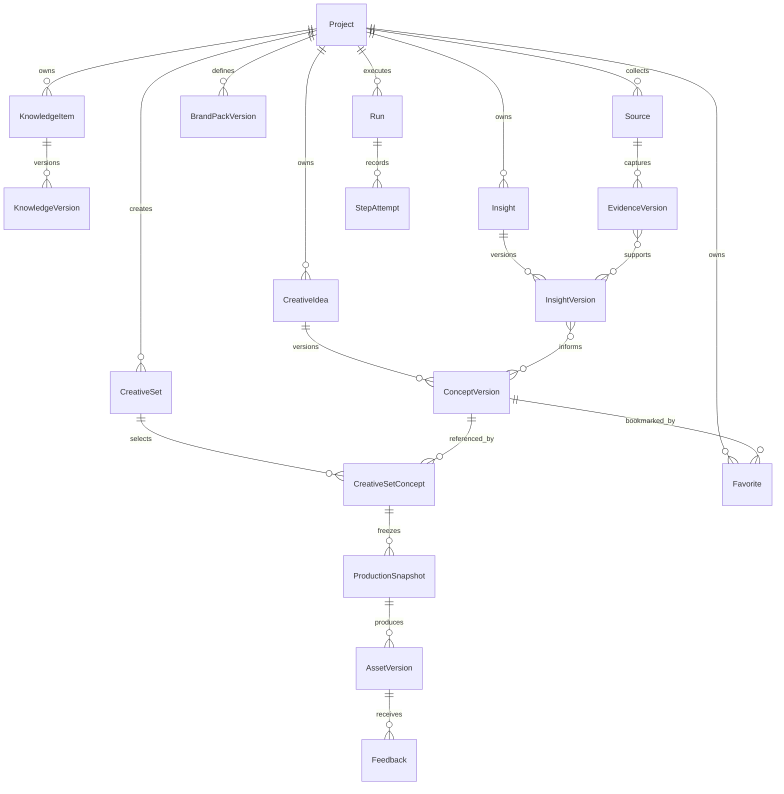

# 领域模型与项目记忆

2026-10-20 补充（ADR-018）：正式 logo 由项目作用域的用户 `brand_logo` selection 指向一个上传资产版本；不从上传顺序推断。ProductionSnapshot 固定 logo id/hash；AssetVersion.branding 与 asset_links 保留该依赖。原生资产另外保存不可变 `productionSource`（同项目 owner、source.png、哈希和尺寸），caption 版本可引用原 owner，编辑只能读取此底图再合成当前 logo。完整私有备份包含底图；成品 ZIP 只含成品与 caption，不包含底图或内部快照。旧版本无底图不伪造数据或覆盖文件。

状态：v0.1 契约 · 2026-10-02，含 Living Project 补充。适用于 [FR-01～FR-16、FR-19～FR-20](../product/prd-v0.1.md)。

实施注记：v0.1 文字子集见 ADR-013；后续 V1 扩展见 [ADR-014](decisions.md#adr-014--v1-沿用本地领域模型扩展版本化创作与受限视觉输入)。SQLite 关系键带 project scope；知识确认产生新版本，选取每个知识项最近的已确认品牌版本，未确认的新草稿不替换旧事实。证据与洞察分开保存身份、版本、来源、假设及反例；过期支持资料默认不自动复用。创意版本固定 parent/idea/run 引用，可手工创建、批量生成及跨 set 关联；收藏独立于创意，采用与发布记录独立。默认反馈只用于指定版本及显式续作的祖先链；asset/set/style/brand/project 范围必须显式指定。当前品牌约束最多 12 条并完整保留，关键词自动检索最多 5 条参考、3 条洞察及其证据、3 条额外相关证据、2 条相关创意和 6 条适用反馈；另加明确选中的前作/图片/brief，以及所选手工创意固定引用的最多 12 条洞察及其支持证据和最多 12 条直接证据；未选原因记录在 manifest。旧事实变化产生提示，旧 context 不改。没有语义检索、自动推断品牌偏好或效果学习。完整实体图仍是设计，不表示所有实体已分别落表；实际文件与关系见 V1 验证记录。

2026-10-05 修正：schema v3 为选择事件增加可空 `set_id`，同项目 `(set, concept)` 外键固定 CreativeSetConcept 范围；新 concept 选用/拒绝必须指定已关联且可写 set。旧全局决策保留为空范围的历史，不能成为任意 set 的批准。`asset_links` 表示输入依赖；新合成无 parent，caption/实际作品修订才引用前版本。旧合成的不可变记录不重写，统一 `assetLineage` 解释其 parent 为历史输入依赖，导出/UI 使用该解释。

手工 ConceptVersion 保存用户身份、可空创建目标、显式 insight/evidence 版本以及创建时确认品牌版本基线；基线不是“实际使用每条事实”的宣称，`runId` 仍为空。`provenance` 保留源 ConceptVersion，后续 context 追溯手工祖先及生成上下文，检查事实变动，引用明确选中的旧证据版本并保留过期提示。历史手工版本无可恢复上下文时标明未知，不生成虚构快照。备份保留这些字段及 set 决策；schema v2 备份可迁移，旧 payload 和哈希不改。详见 ADR-015 和当前验证记录。

## 核心关系



关系是业务设计，不是已落地 SQL。多对多引用在实现时用关联表；所有项目域实体的引用必须在服务和数据库约束层校验项目一致性。

Project Memory 是这些本地领域对象及引用的总称，不是新增数据库或 runtime 的永久聊天。CreativeIdea 是项目创意的稳定身份，沿用 `ConceptVersion` 命名表示它的不可变内容版本；CreativeSetConcept 将 set 与具体版本关联。创意不依赖某个 set 存活，同一版本可用于多个 set；不建立一套重复的 IdeaVersion / ConceptVersion 数据。

## 实体契约

项目域版本化实体保存 `id`、`project_id`、`schema_version`、`created_at`、`created_by`、`content_hash`。全局 SkillPackageVersion 不带品牌内容，通过 ProjectSkillBinding 绑定项目允许的版本；不能强行把共享方法包归到某个品牌。时间存 UTC，界面按用户时区显示；对象 ID 与可变显示名称分离。

| 实体 | 必需业务字段 | 约束 |
|---|---|---|
| Project | 名称、状态、默认语言、当前品牌版本 | 名称非唯一身份；归档保留关联 |
| KnowledgeItem / Version | 类型、内容、来源、确认状态、有效期/适用范围、前版本 | 模型草稿不能直接变 confirmed |
| BrandPackVersion | 产品事实引用、tone、claims/限制、颜色/字体/资产、风格系列 | 发布版本不可变；未知字段不自动填充 |
| Source / EvidenceVersion | URL 或导入文件 ID、标题、published_at 可空、retrieved_at、来源类型、摘录、支持的论点、访问状态 | 每次采集保留不可变证据版本；网页快照/摘录遵守可访问与保存范围；搜索摘要不伪装原文 |
| Insight / InsightVersion | 稳定 insight ID、版本、前版本、audience、场景、pain/desire/objection/job、观察、推断、证据版本 ID、反例、适用范围、confidence 理由 | 无证据标 hypothesis；手动任务可新增候选版本，不覆盖旧引用、不自动成为品牌事实 |
| CreativeSet | mode、目标、brief 版本、语言、选定证据/假设、状态 | `paid/organic` 与投放平台对象无直接等同关系 |
| CreativeIdea | project_id、当前版本、生成/手动/改编来源、可空 origin_run_id、可空 parent_idea_id、归档状态 | 属于项目；可在没有 set 和完整 brief 时创建；生成结果默认持久保存 |
| ConceptVersion | idea_id、前版本/衍生来源版本、insight_version_ids、angle、theme、headline/body/caption/CTA 草稿、视觉方向、事实引用、构思目标 | 不可变；未知字段可空，制作前补齐 brief；只改文字也建新版本 |
| CreativeSetConcept | project_id、creative_set_id、concept_version_id、选择状态、选择/拒绝原因、衍生来源引用 | 同项目显式关联；不同 set 的选择状态独立，换版本需重新检查下游批准 |
| Favorite | project_id、concept_version_id、收藏时间、可选原因、取消时间 | 活跃收藏按项目与版本唯一；固定版本，不随“当前版本”漂移；取消不删除创意 |
| StyleProfile | 名称、视觉规则、参考图、检查项、适用范围、版本 | 一个品牌可有多个风格系列 |
| SkillPackageVersion | 来源、内容哈希、版本、license 信息、能力/权限要求 | 包内容不可变；项目启用与全局安装分开 |
| ProductionSnapshot | 下列快照契约 | 运行绑定不可变输入，不能读“最新”代替固定版本 |
| AssetVersion | 文件引用、sha256、MIME、尺寸、parent_asset_version、snapshot_id、状态 | 新编辑生成新版本，不能覆盖原文件 |
| Approval | actor、scope、subject_version/hash、预算/路线范围、时间、状态 | 输入改变使对应批准失效；agent 不是审批人 |
| Feedback | 原文、分类、scope_type/scope_id、目标版本、选定/拒绝理由、提议变更引用 | 创意阶段默认当前创意版本，Studio 默认当前资产；扩大范围需用户动作 |
| PublicationRecord | set/asset 版本、手动状态、时间、可选渠道/链接 | `exported` 不等于 `published`；无数据不生成效果指标 |
| Run / StepAttempt | project_id、task_type、可空 creative_set_id、状态、lease、输入哈希、route、事件、输出、usage | 独立任务不要求有 set；业务历史不依赖 provider session 是否存在 |

## 收藏、历史使用与跨次发展

持久保存是所有有效创意输出的默认行为；Favorite 是独立的书签关系；Used 由 set 的实际发展/制作关联派生，并区分“已引用”与“已制作”。Rejected 是一次选择或反馈事件；Archived 是可见性/生命周期状态。它们不构成 `generated → saved → favorite → used` 的互斥状态机，也不等于最终采用或发布。v0.1 不额外实现第二套 Saved 按钮。

复用固定版本时建立新的 CreativeSetConcept 关联；按新 brief 改写则创建 ConceptVersion，保留来源版本，新变体可建立带 parent_idea_id 的 CreativeIdea。旧创意、收藏与原 set 的版本保持不变。继续制作前核对当前事实，创建新的制作快照与批准；源 set 归档不删除独立创意。归档创意默认不参与新任务自动选材，但历史引用和收藏仍可查看并提示归档状态。

## 研究与洞察生命周期

研究任务无须关联 Creative Set，产物是项目 Source / EvidenceVersion 及研究记录。洞察整理也是独立任务，可以只选已有证据；用户明确选定组合任务时，才将研究结果交给洞察整理。每次更新用稳定 Insight ID 关联不可变 InsightVersion，保留修订理由和证据变化；旧 concept/snapshot 继续引用旧版。

Agent 可在获准任务中提交洞察候选版本，不能把推断标为用户已确认事实。冲突版本并列展示，未经用户取舍不自动替换既有选定版本；影响品牌知识时另走 KnowledgeChangeProposal。证据失效或受众改变显示时效/范围提示，不自动触发外部研究。收藏或采用次数不是 Insight 的证据，不自动提高 confidence。

## 制作快照最小结构

以下是应用内部结构示例，不是任一 provider 的 API 请求。ID 为示意值，不包含真实品牌事实。

```json
{
  "schema_version": 1,
  "project_id": "project-a",
  "creative_set_id": "set-001",
  "brief_version_id": "brief-v1",
  "brand_pack_version_id": "brand-v3",
  "concept_version_id": "concept-v2",
  "creative_set_concept_id": "set-concept-001",
  "insight_version_ids": ["insight-v1"],
  "evidence_version_ids": ["evidence-v1"],
  "hypothesis_ids": ["hypothesis-001"],
  "style_profile_version_id": "style-v1",
  "skills": [{"id": "editorial-photo", "content_hash": "sha256:..."}],
  "reference_asset_version_ids": ["reference-v1"],
  "composition": {"mode": "whole_image", "template_version_id": null},
  "requested_output": {"aspect_ratio": "4:5", "language": "en"},
  "route_id": "codex-native-profile-1",
  "capability_snapshot_id": "capabilities-001",
  "approval_id": "approval-001",
  "context_manifest_id": "context-001",
  "input_hash": "sha256:..."
}
```

实际执行结果另外记录 runtime/model/adapter 版本、已解析参数、改写后的有效 prompt（可获得时）、request/thread/turn ID、工具调用、输出哈希与用量。Provider 隐藏模型或参数时标 `unknown`，不能只记录我们请求的值然后冒充实际值。

## 记忆层次和更新规则

| 类型 | 是否进入下一轮上下文 | 谁能修改 |
|---|---|---|
| 原始资料 | 按任务相关性选取，带来源身份 | 用户导入；删除后引用保留 tombstone |
| 已确认品牌/产品知识 | 默认优先使用适用的当前版本 | 用户确认变更后发布新版本 |
| 研究证据 | 按受众、问题、时效选取 | agent 可新增；不能篡改来源为事实 |
| 洞察/策略假设 | 可用但必须带假设身份 | agent 提议，用户可选用/拒绝 |
| 项目创意与收藏 | 按当前任务相关性取具体版本，可标明收藏理由和使用历史 | 创意任务可新增版本；收藏/取消由用户明确操作 |
| 创作偏好与反馈 | 仅在声明范围内生效 | 用户明确反馈；推导规则须确认 |
| 内容覆盖历史 | 用于减少重复主题 | 由采用/导出/手动发布事件派生 |
| Runtime conversation/checkpoint | 仅服务绑定任务 | 由 adapter 管理，可重建，不是项目真相 |

知识状态建议：`draft → confirmed → superseded/retired`。研究里的“观察”是对来源的记录，`confirmed` 品牌事实是用户授权的产品陈述，不能混成一个可信分数。

新资料与已确认事实冲突时生成 `KnowledgeChangeProposal`：列出旧值、新值、来源、适用范围和受影响产物。用户处理前旧版本保持有效，冲突明确可见；不可让“较新的模型回答”自动胜出。

## 上下文构建顺序

1. 服务端确定项目、任务角色、版本快照和允许的材料范围。
2. 取出适用品牌约束、本次目标及存在时的 brief / 选中 concept；独立研究或构思不要求存在 set，明确本次允许修改什么。
3. 加入支持当前 insight 的证据及必要反例，保留 URL/文件引用与访问状态。
4. 加入本次启用的 Skill 入口；按需要附 references/assets，避免把全部库塞入上下文。
5. 按受众、目标、语言、时效与作用范围选取少量相关创意、收藏及反馈，兼顾近期内容去重；收藏仅是候选信号，不压过当前 brief 和品牌约束，也不要求每次模仿历史喜好。不将旧作品文案升级为产品事实。
6. 写出 ContextManifest：所有材料 ID/版本、选取理由、遗漏和截断。超限时先压缩低优先级材料；品牌禁用承诺不能被静默截断。

第一版使用结构化筛选和全文检索。向量搜索可后加，但不能替代项目过滤、版本规则或事实确认。

ContextManifest 额外记录本次 task_type、选入的 insight/concept 版本、收藏/反馈引用、选取理由及过期/冲突提示；“相关上下文包”是该快照的用户可理解名称。不得将全部历史无界塞入上下文，或自动概括成未经确认的品牌 taste 规则。

## 变更影响

| 变化 | 失效/需要重做的内容 |
|---|---|
| caption 拼写 | 文案导出；若文字烤在图里，制作步骤也过期 |
| 图片风格 | 制作与视觉检查；保留已选研究、insight 和文案 |
| 价格、承诺或产品功能 | 依赖该事实的 concept、图中文字、检查及最终批准；旧成品标过期风险 |
| Skill 新版本 | 仅影响用户选择使用新版本的新任务；在途快照保持原版 |
| 来源被删除/失效 | 证据标缺失/过期，引用历史保留；不伪造仍可访问 |
| 新洞察或创意版本 | 旧收藏、旧 set 与在途快照不自动换版；用户改用新版时重建受影响计划 |
| 收藏/取消收藏 | 改变后续选材候选；不改品牌事实、不删除旧产物、不改变在途快照 |

历史输出不删除，不自动在外部撤回。继续发布旧输出前提示其事实已改变，要求按新事实检查。

## 隔离和可移植性

所有查询包含 project scope；缓存键包含 project ID、输入版本哈希、Skill/adapter 版本与参数。默认不做跨项目上下文/资产缓存复用，即使文件哈希相同。

跨项目复用必须是显式导出/导入，创建目的项目的新对象并保留来源记录；全局共享仅限无品牌内容的工具设置和方法包。Runtime thread 与项目一对一绑定，不允许切换项目后复用旧会话。

普通成品导出与私有备份分别建 manifest。成品清单含项目/set/asset 版本、文件名、尺寸、输出语言和制作标识；完整备份包含知识与内部血缘。两者都不携带凭证。

完整备份必须包含未进入任何 set 的 CreativeIdea / ConceptVersion、Favorite、InsightVersion 和 CreativeSetConcept；恢复后固定引用与收藏状态一致。Favorites 按 project scope 查询与校验；跨项目复用仍必须显式导出/导入新对象。
