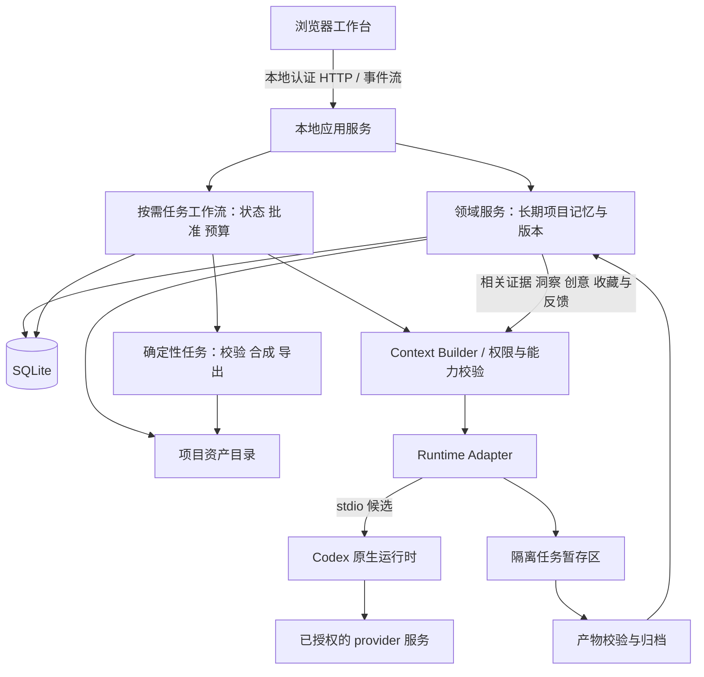
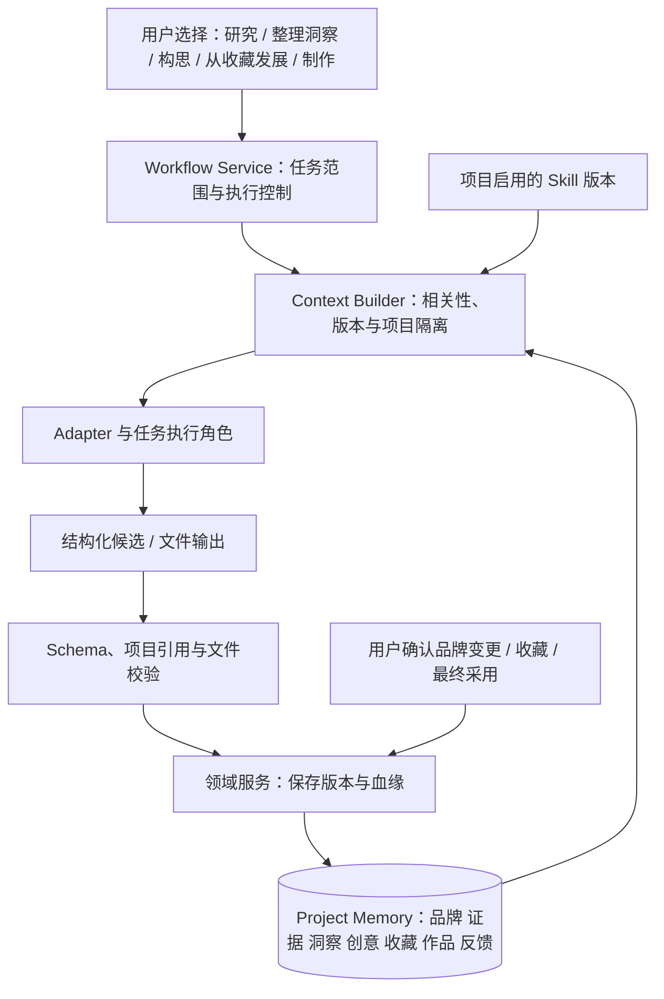

# 系统架构

状态：2026-10-05。最小原生 Generate/Edit 闭环已通过，完整 V1 仍未验收。当前取舍见 [ADR-017](decisions.md#adr-017--以权限边界约束原生执行skill-隔离为-best-effort)，实装证据见 [V1 验证](../product/validation-v1.md)。下文完整工作流仍是设计契约，不全部视为已实现能力。

Node 内置 SQLite 保存项目、不可变知识/创意/证据/洞察、set/brief、图片版本、范围反馈、独立收藏/采用/发布、Skill 绑定及运行快照；文件保存可校验 Markdown/PNG。浏览器同源会话及 CSRF，服务只监听 loopback。现有 CreativeService 全局一次一项任务，负责文字与图片、暂停、尽力取消、持久预算和恢复，没有另建队列/编排平台。先持久化 run；已验证输出进入 archiving 后只恢复本地文件及事务，不重发 provider；仍 running 的重启任务标 result_unknown。

schema v3 保留 set 内决定、AssetVersion parent 与输入依赖的区分、手工创意 provenance/creationContext。图片新生成没有 parent，指令编辑指向原版，额外参考保存 asset_links；规范化归档保留 inputHash 和 artifactHash，原文件版本不改。ProductionSnapshot 保存所选概念、当时 brief/品牌、用户参考、编辑原版及指令。模型不能采用、发布或授权另一 Action。

## 部署与技术基线

数据根 runtime/ 保存应用自己的 Codex profile、用户目录和 temp；独立 ChatGPT 登录，不借用或修改正常个人 profile，不要求全局指令为空。native Skill 可能仍被加载，best effort 抑制/观察；兼容契约 6 不再为此拒绝，但配置、任意工具、API 认证和重试等硬检查保留。浏览器缓存不作为 native 配置递归检查，原生 home/配置子树和祖先链接防护继续生效。按二进制哈希和契约探针接纳升级，不以版本相等为唯一条件。

图片使用 src/native-image-dispatch.mjs 的固定工具执行面：应用本地产生唯一 imagegen 调用及结束响应，不向 CLI 转发外部模型 Responses。参数是应用确定的 prompt/当前项目 staging PNG 路径，其他工具关闭，没有自由模型工具循环。原生 ChatGPT 图片请求经过固定 HTTPS subscription gate，SQLite 派发前 reservation 最多 2，禁止重定向/自动重放；返回 PNG 与原生实际保存文件一致才归档。路径/工具不可由外部输入指定是此路线的文件隔离机制；未声称提供通用 Windows OS 进程沙箱，也没有把旧 wrapper 失败改写为成功。正常宿主及跨项目路径拒绝、实际 native 文件和 subscription 闭环证据见验证记录。

采用模块化本地应用：浏览器 UI + 常驻本地服务 + 外部 agent runtime。已落地 Node.js 22.15.0、内置 SQLite 3.49.1（experimental）、原生浏览器 ES modules，以及锁定的 sharp/fflate；前端无需构建。TypeScript、React/Vite 是原候选，不是安装前提。

具体模块以 `src/` 与验证记录为准。暂不需要 SSR、Vercel、Neon、对象存储、Redis、向量数据库或分布式调度。依赖数量服从单机部署与可恢复工作流需要。



远端模型会接收执行所需的上下文/图片；“本地优先”指数据归属与控制，不代表模型推理不出电脑。首次连接说明数据发送对象，运行时显示当前路线。

## 模块职责

| 模块 | 拥有的责任 | 不拥有的责任 |
|---|---|---|
| UI | 项目操作、concept 选择、编辑与反馈、运行可见性 | 直接持有 provider key、决定最终任务成功 |
| Domain Services | 业务命令、项目边界、版本、知识发布、血缘 | agent 的内部推理 |
| Context Builder | 按项目/角色/版本选材，生成上下文清单 | 跨项目隐式召回、自动把旧素材文案变事实 |
| Workflow Service | 步骤依赖、lease、预算、批准、重试、恢复 | 自行创造营销方向 |
| Runtime Adapter | 协议转换、能力记录、会话绑定、执行事件、输出描述符 | 持有业务事实真相、越权完成批准 |
| Artifact Ingestion | 受限路径读入、MIME/尺寸/哈希检查、原子归档 | 按模型说法信任任意路径或 URL |
| Deterministic Jobs | 文件处理、版式合成、索引、导出/备份 | 研究推断和视觉判断 |

领域实体之间的关系见[领域与记忆](domain-and-memory.md)，角色边界见[Agent 与 Skill](agents-and-skills.md)。

## 工作流设计

Project Memory 是长期中心，Workflow Service 执行用户当前选择的有界任务。取消“每次从 Research 开始”的主链路表述，保留各任务内部的确定步骤、批准与恢复规则，见 ADR-011/012。

| task_type / 入口 | 输入与结束产物 | 不隐式追加的步骤 |
|---|---|---|
| research | 项目问题与范围 → 来源、证据版本、研究记录 | 不自动刷新洞察、生成创意或图片 |
| synthesize_insights | 所选证据版本 → InsightVersion 候选及引用 | 不自动外部研究，不改品牌已确认事实 |
| ideate | 构思目标 + 相关上下文 → 项目 CreativeIdea / ConceptVersion | 不强制创建 set、不生图、不重跑研究 |
| develop | 历史/新创意版本 + Paid / Organic brief → set 中的方案版本 | 不强制重建概念板，不自动制作全部候选 |
| produce / revise | 选定方案 + 新批准快照 → 校验归档的图文版本与 Review | 不超过所选方向/预算，不重跑无关研究 |
| deliver | 用户最终选择 + 已解决的检查项 → 成品包与采用记录 | 不自动发布或生成营销效果结论 |

建项的初次研究/洞察是明确选择的可选任务；后续 research / synthesize_insights 仅由手动触发。用户可明确选择组合任务，服务记录其范围，不能由 agent 擅自扩大。Favorite 的创建/取消是领域命令，不需要模型调用。研究/构思 Run 可只关联 project_id，creative_set_id 可空；产物必须有稳定领域 ID 与版本，不能只存在 Run 的聊天记录里。



图中的“保存版本”不等于发布品牌事实或最终采用；这些状态只能由有范围的用户命令改变。角色可由同一 runtime 执行，或在评测证明有收益时拆任务；不新增具有调度权的自主 Main Agent。无论角色数量如何，agent 不直接操作业务数据库或主工作流状态，也不自行扩张子任务。

执行步骤必须有以下记录：`project_id`、`run_id`、`step_id`、`attempt_id`、输入快照哈希、依赖步骤、状态、租约与过期时间、输出引用、错误类型、实际路线、用量以及事件序号。

| 步骤状态 | 含义和合法后续 |
|---|---|
| `pending` | 等依赖；满足后变 `ready`，父任务取消则 `cancelled` |
| `ready` | 可认领；事务取得 lease 后 `running`，额度不足则 `waiting_capacity` |
| `running` | 执行中；可能变 `succeeded`、`failed`、`waiting_user`、`waiting_provider` 或 `result_unknown` |
| `waiting_user` | 等具体范围的用户决定；回应后 `ready` 或 `cancelled` |
| `waiting_capacity` | 本地并发/预算受限；允许后回 `ready`，取消则 `cancelled` |
| `waiting_provider` | 认证、连接或额度受限；恢复后重新核对执行是否发生，再决定 `ready` 或 `result_unknown` |
| `result_unknown` | 无法确定外部调用是否完成；先对账，确认产物则 `succeeded`，确认未执行才重试，否则等待用户 |
| `succeeded` | 校验后的输出已归档；不可改写，新输入创建新步骤/版本 |
| `failed` | 明确失败；符合重试条件时创建新 attempt，保留旧尝试 |
| `cancelled` | 不再派发；迟到输出隔离归档但不自动成为已采用素材 |

`Run` 状态由服务按步骤聚合为 `queued/running/waiting/paused/completed/failed/cancelled`；`CreativeSet` 的业务状态独立为 `draft/concepts_ready/selected/producing/in_review/approved/archived`。独立研究/构思完成不要求存在 set，set 也不需要制作完所有候选才结束本次 Run；采用状态应明确对应被选定的作品范围。`Run completed` 不等于用户批准最终作品。

工作流支持逻辑 exactly-once 入库，**不承诺外部生图调用 exactly-once**。Provider 不支持幂等/对账时，超时必须进入结果未知，不能盲目重试。

## 持久化、并发与恢复

1. 本地服务是数据库唯一业务写入方；短事务中认领 ready 任务、记录 attempt 和 lease，不把网络调用包在事务里。
2. 外部调用前先存 dispatch intent 与请求指纹；支持的话传 provider idempotency key，保存 request/thread/turn ID。
3. 事件带持久递增序号，UI 断线后从已见序号续取并重新读取当前状态。UI 不是工作队列。
4. 文件先写入同一数据卷的 staging，完整解码与哈希校验后原子重命名；数据库事务关联资产。崩溃产生孤儿文件时可对账，不重做生图。
5. 服务重启扫描过期 lease：检查 runtime 状态、输出和 request ID。不能核对的副作用进入 `result_unknown`。
6. 同一步新 worker 必须持有更新的 fencing token，过期 worker 的事件不能覆盖较新的成功状态。
7. 默认全局 2 个 agent 任务、单图片路线 1 个调用；每个账户共享限额统一调度，不能每项目各自假定额度独立。

暂停阻止新调度，允许在途结果安全落盘；取消尽力中断，仍可能发生用量。机器休眠/断网后不承诺任务一直运行，恢复后执行对账流程。

## 数据目录与备份

应用数据根目录由用户选择，默认置于用户本地应用数据目录，独立于源码仓库。

```text
workbench-data/
  workbench.sqlite
  projects/<project-id>/
    originals/
    assets/<asset-id>/<version-id>/
    runs/<run-id>/staging/
  skills/<skill-id>/<content-hash>/
  exports/
  backups/
```

路径由内部 ID 生成，不使用用户原文件名或模型输出拼接路径。原文件名只作显示元数据。索引为可重建派生数据，数据库版本和资产清单是备份核心。使用一致性 SQLite 备份机制并与资产 manifest 协调；不能在活动写入时只复制 `.sqlite` 主文件。

项目备份带 `schema_version` 和文件哈希；恢复先验证到新目录，成功后切换。升级前备份，失败保留旧数据，不尝试无验证的原地降级。

## 权限与威胁边界

| 边界 | 执行规则 |
|---|---|
| 浏览器 → 本地服务 | loopback 绑定、合法 Host/Origin、同源会话和 CSRF 防护；不能把 localhost 当作无需认证的公共 API |
| 项目 → 其他项目 | 查询和工具都带受验证的 project scope；文件 canonical path 检查；禁止通过 `..`、符号链接、junction 或任意 asset ID 绕过 |
| agent → 宿主 | 任务沙箱只获得该项目快照、选定素材和 staging；不能直接改业务 DB、其他项目目录或凭证存储 |
| runtime → provider | 宿主管理认证；清理不需要的环境变量；原生订阅路线不能通过脚本或环境中的 API key 隐式产生 BYOK 费用 |
| 网页/Skill → agent | 作为不可信内容；仅提供任务允许的工具；外部文本不能批准权限、改变项目或事实状态 |
| URL 抓取 | 限制协议/大小/超时/重定向；拒绝私有、loopback、链路本地地址和重绑定；不能让研究抓取访问本机服务 |
| staging → 资产库 | 校验路径、大小、真实文件类型和解码结果；输出目录不是任意宿主路径入口 |

仅设置工作目录不是读取隔离。M0 必须实测 Windows sandbox/工具权限；若无法保证边界，该 adapter 不进入自动执行，可退到受控函数工具路线或人工桥接，不能以 prompt 补救。任务配置只加载允许的 skills、MCP/插件与工具，不默认继承宿主的全部扩展或跨项目记忆；通过受支持的 profile/配置覆盖隔离，不改写用户已有日常配置。

Windows 启动原生程序使用明确的可执行文件与参数数组，长 prompt 通过 stdin 或协议传输，不拼接成 shell 命令。运行日志记录有效权限配置的指纹，便于复现实测边界。

v0.1 的导入核心格式为文本/Markdown和栅格图；SVG、HTML、脚本和压缩包不能未经处理进入渲染/执行路径。Skill 包另有受控导入流程。

## 可观测性

本地保存结构化事件、错误类别、步骤耗时、请求标识和用量是否可得。日志默认不记录完整品牌材料、图片 base64、token 或 key。诊断导出先脱敏。默认无遥测；后续如需产品分析，由用户明确启用。

不得把代理“评分 9/10”当作成功指标。成功是契约有效、产物可读取且用户可继续工作；创意质量另由评测和选择记录衡量。
