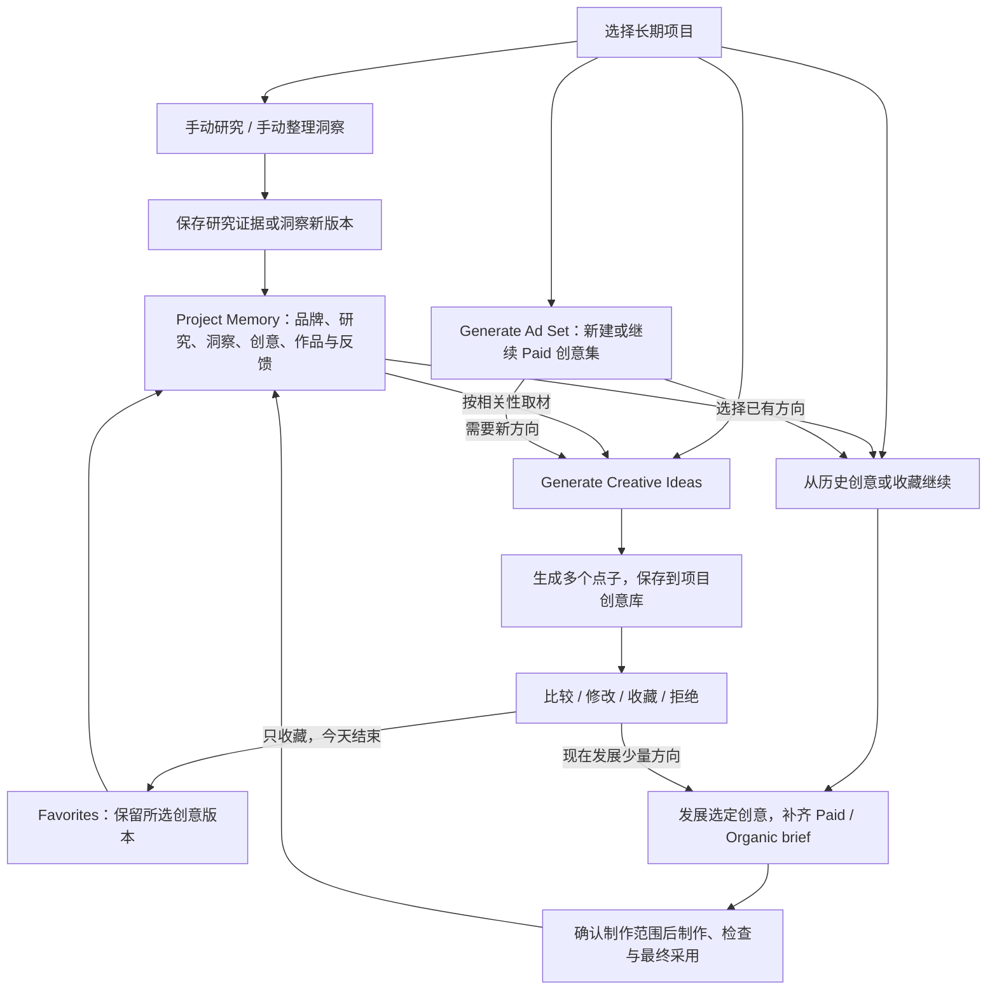
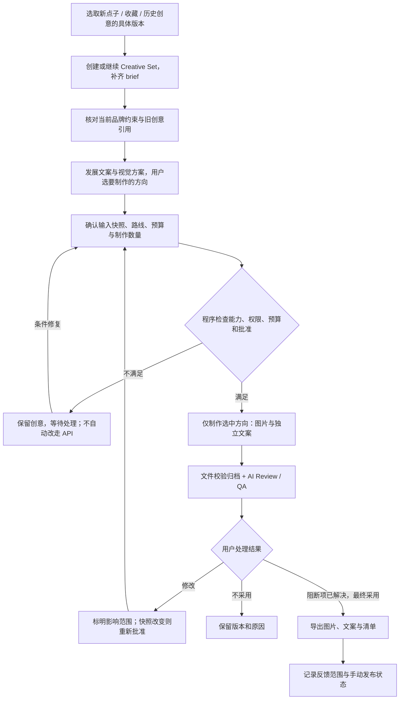

# 用户流程与信息架构

状态：v0.1 设计 · 2026-10-02。功能规范以 [PRD](prd-v0.1.md) 为准。

## 信息架构

全局只保留项目切换、运行时连接和 Skill 库。项目是长期工作空间，项目内分为概览、知识、创意库、创意集、资产库与运行记录；Research Library / Insight Bank 是知识视图，Favorites 是创意库的收藏视图。无需为这些逻辑分区建立独立服务或强行限制页面数。

| 区域 | 主要内容 | 主要动作 |
|---|---|---|
| 项目概览 | 当前品牌版本、近期洞察/创意、未完成任务 | Generate Creative Ideas、Generate Ad Set、从收藏继续 |
| 知识 | 原始资料、品牌事实、Research Library、Insight Bank、风格系列 | 导入、手动研究、手动整理洞察、确认品牌版本、处理冲突 |
| 创意库 / Favorites | 所有创意版本、收藏理由、使用记录、关联 set | 收藏/取消、筛选、修改、从历史创意继续发展 |
| Creative Set / 概念板 | brief、概念卡、选中理由、制作计划 | 比较、修改、选定、制作 |
| Studio | 图片版本、文案、参考图、Skill、检查结果 | 编辑图片、改文字、生成变体、采用 |
| 资产库 | 预览、版本、标签、导出/发布状态 | 筛选、查看来源、继续修改、导出 |
| 运行记录 | 阶段、路线、用量、错误和可恢复动作 | 暂停、恢复、取消、查看诊断 |

主要页面持续显示当前项目。普通用户先看到“使用已有研究”“换成手绘风格”等任务动作；模型/runtime/快照字段放入可展开的制作详情。

## 首次使用

1. 创建本地工作区，选择数据目录；连接现有 Codex runtime。
2. 显示连接与实际探测结果：研究可用、参考图待验证、生图不可用等，不显示笼统的“全部已连接”。
3. 创建项目，提供名称与简短描述；可导入已有产品资料、logo、参考图。
4. 系统提取 Brand Pack 草稿，突出未知和冲突；用户确认最小事实，或明确以探索模式继续。
5. 可选“初次客户研究”和“基于所选资料整理洞察”；用户选择后执行，分别沉淀到项目。两者均可跳过，不影响进入创意工作区。
6. 生成第一批创意或创建首个 Creative Set。没有图片能力时，知识、洞察、创意和收藏仍可保留，制作入口明确说明限制。

“探索模式”仍不得虚构价格、测试数据或保证；区别只是可以使用标注的受众/创意假设。

## 项目长期循环与独立入口

这些入口不要求互相串行。手动研究可独立结束；整理洞察可以仅用已有证据，不新增外部研究。新研究不会自动触发洞察重写、创意或生图；用户可明确选择一次运行研究与洞察两个任务。创意任务发现资料缺口时只提出建议，用户决定是否发起补充任务。

Research / Insight / Creative Bank 是长期项目内容；Favorites 是书签引用，Creative Set 是一次有 brief 的工作单元，Run 是一次执行记录。保存研究/洞察不等于确认品牌事实；涉及品牌变化仍走变更提议与用户确认。

## 从选定创意到制作

从收藏进入时直接发展该想法，不强制生成另一批概念。用户可以只改文字、只发展方案或只制作一两个 post，未选中的创意保留。已采用或使用过的点子仍可收藏、再次使用；不复用旧 set 的执行批准。制作中改变快照后，必须重新通过批准与能力检查，不能从“修改”直接绕回生图。

## Paid 与 Organic 的差异

| 字段 | Paid | Organic |
|---|---|---|
| 意图 | 测试一个营销假设、推动指定行动 | 教育、讨论、故事、观点、产品用法等 |
| 文案结构 | hook、headline、body、proof、offer、CTA | 主题、hook、caption、可选互动问题/CTA |
| 判断重点 | 是否对指定受众表达清晰价值，承诺是否有依据 | 是否提供内容价值，是否与近期主题重复 |
| 共用结构 | insight、angle、视觉方向、语言、参考图、风格、版本 | 同左 |

Paid 的 Creative Set 不是 Meta Ads 的 Ad Set 对象，不包含真实投放受众、预算、出价或广告账户 ID。

## 概念卡必须可比较

每张卡显示一句核心创意、目标受众、insight/依据、angle、headline 或 caption 草稿、视觉描述与建议风格。研究支持不足时清楚标为“待验证假设”。

用户可修改文案、收藏/取消收藏、选定 concept、指定“更多像这个”、拒绝并写原因。所有点子在生成后已保存，收藏只标出想再次取用的具体版本；不要求收藏才持久化。缩略草图不是必需，避免尚未选方向就大批生图。

独立 brainstorm 只要求构思目标与可用项目上下文；概念卡的未知信息保持未知。进入 Paid / Organic set 后补齐相应 brief。v0.1 先收藏创意；收藏任意 insight/图片等对象是后续候选。

## 跨次复用示例（验收情境，不是真实运行记录）

第一天：手动研究并整理洞察 → 生成 6 个点子 → 收藏 2 个 → 只发展并制作其中 1 个。第二天：打开同项目 Favorites → 取另一个收藏版本 → 核对当前品牌和 brief → 直接发展、确认、制作。第二次不自动 research、不重新生成整张概念板，第一次的作品与另外 4 个未收藏点子仍可查。

收藏、拒绝、使用和采用原因以明确范围写回 Creative Memory。下一次任务可检索相关例子，说明为何选入；不会据此自动发布品牌偏好规则、强化某个洞察的证据等级或推断 CTR/转化提升。

## 反馈与修改范围

| 用户动作 | 默认影响 | 保留内容 |
|---|---|---|
| 收藏点子或记录拒绝原因 | 当前创意版本的书签/反馈 | 品牌规则、其他创意、已有作品与批准快照 |
| 只改 caption | 当前文案版本 | 图像、研究、concept |
| 当前图不要蓝色 | 当前资产新版本 | 品牌配色和其他资产 |
| 保留文案，换手绘风格 | 当前 concept 的制作任务 | 已选 insight、文案和研究 |
| 这套内容都采用更克制语气 | 当前 Creative Set 新版本 | 项目默认语气 |
| 将语气更新为品牌规范 | 提交 Brand Pack 变更草稿并确认 | 历史快照不可变；衍生内容标记可能过期 |

修改影响已批准制作快照时，旧批准不能用于新计划。先展示受影响部分，再确认新的执行范围。

## 关键异常状态

| 状态 | 用户应看到的含义 | 可用操作 |
|---|---|---|
| 登录/授权失效 | 当前执行端需要重新连接；资料仍保留 | 重连、查看已完成结果 |
| 订阅额度不足 | 当前路线暂停；没有自动启用 API | 等待、取消、主动配置其他路线 |
| 研究无可靠来源 | 本次观点只能作为假设 | 补充资料、缩小问题、继续探索 |
| 服务重启 | 正在核对外部任务与已保存产物 | 查看完成步骤、等待核对 |
| 外部结果未知 | 请求可能已被执行，不能安全自动重发 | 对账、导入已生成文件、明确批准新尝试 |
| Skill 不兼容 | 缺少具体能力或权限 | 换 Skill、换已授权路线、查看要求 |
| 图片已生成但归档失败 | 有候选输出，保存尚未完成 | 重试归档，不重新生图 |
| 用户暂停 | 停止派发后续步骤；在途请求可能仍完成 | 恢复、取消 |
| 用户取消 | 不再调度；provider 可能无法撤销在途请求 | 保留已完成产物，展示可能发生的用量 |

确认最终采用时，将 AI 检查结果作为辅助；用户的作品选择和真实营销效果分别记录。
