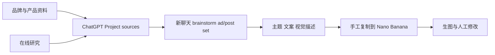

# 创始人需求上下文

记录日期：2026-10-02。来源为用户提供的 `Pasted text.txt`，以及本轮对两项澄清的答复。原附件共有 837 行；没有附带可供本次查看的历史作品图片。附件 SHA-256 为 `e7bc12249a3e397061244d30f130497ace0b06b420ada61f18710caed576d570`，用于对应本次输入，不代表本仓库保存了原附件。

原对话包含用户陈述与 GPT 建议。本文件只把用户陈述标记为需求证据；品牌示例、模型宣传和 GPT 的架构建议另行审查。原始长对话未整段复制入知识库，避免后续把未经核实的建议当成规范。

## 已明确需求

| ID | 用户陈述或明确偏好 | 对应含义 |
|---|---|---|
| U-01 | 自用的内容生成平台，主要生成营销图片 | 首要用户是用户本人，核心产物是可使用的图文内容 |
| U-02 | 用于 Facebook/Instagram 日常运营及 paid campaigns | Organic 与 Paid 都需要，目标和 brief 有区别 |
| U-03 | 已经每天有使用需求，现有手工流程确实产出作品 | 重点验证质量和操作节省；市场普遍需求尚未验证 |
| U-04 | 在 ChatGPT Project 保存品牌、产品和研究资料 | 知识持久化和后续复用是基础需求 |
| U-05 | 先研究用户痛点、现有解决方式和产品/竞争环境 | 研究服务创意，不局限于关键词生成 |
| U-06 | GPT 产出完整 ad/post set，再复制给 Nano Banana | 产品单位应是一套创意及关联资产，而非孤立 prompt |
| U-07 | 开源；偏好 BYOA、已有订阅；BYOK 可作为方式 | 优先验证订阅路径，不能默认要求新的 API 账单 |
| U-08 | 希望按 research、creative、production 等职责协作的 multi-agent | 角色分工应清晰，同时要判断哪些工作用固定程序更合适 |
| U-09 | 同一个账户管理 RidePass 等多个项目，各有独立 memory | 单人多项目隔离从第一版开始 |
| U-10 | 需要灵活 skill 管理、品牌资产/design system 支持及视觉一致性 | Skill、Brand Pack 与风格系列需要独立建模 |
| U-11 | 参考优秀开源项目，举例不是绑定技术选型 | 比较具体机制与适配成本，不按名单照搬 |
| U-12 | 本轮确认 Windows 本机启动、浏览器操作、先单人多项目 | v0.1 部署和账户范围已确认 |
| U-13 | 本次补充：research、insight 不应每次创作都重跑；新建项目时可做初次研究，之后手动触发 | 研究和洞察是独立项目任务；日常创意默认复用已存结果 |
| U-14 | 经常点击 generate ad set / creative ideas，生成几个想法供选择；一次可能只制作一两个 post | 支持仅构思、分批发展与制作；不要求一次生成全部图片 |
| U-15 | 用户可以 bookmark 好点子到 favorites，下次使用；输出应保存复用 | 项目创意库、收藏和跨次续作进入 v0.1 |
| U-16 | Project 是长期维护的 living project，研究和 brainstorm 持续沉淀并产生复利 | Project Memory 是产品中心；持续复用上下文和判断历史，改善效果仍需验证 |

U-03～U-11 的主要原文位置在附件 507～527 行。用户在本轮确认了 [小黑 skill](https://github.com/helloianneo/ian-xiaohei-illustrations) 和 [OpenShip](https://github.com/oblien/openship) 的准确仓库，并强调应广泛汲取适合本产品的机制。

## 现有工作流

已知的手工作业包括上下文搬运、资料回存、跨工具交接与修改协调。具体耗时、成本、一次可用率均未知。

## 不能从对话推出的事实

- GPT 提到了截图中的车型/场景和服务承诺，但本次只收到文字；没有验证图片质量或 RidePass 的真实承诺。
- “8:45 到达保证”“1 Driver”、Goodstuff 和 invoicing SaaS 等表述都不能直接进入品牌已确认事实。
- 用户觉得过去 Nano Banana 效果较好，是有价值的个人经验，不是当前模型排名。
- 用户希望 multi-agent，不代表每次任务必须启动所有角色，也不代表效果已胜过单 agent。
- 支持不同项目不等于需要云端多租户账户、团队权限或复杂组织管理。
- 第一版的技术栈、量化目标、页面布局和里程碑是本次产品/架构建议，不冒充既有用户承诺。

下一步需要的真实业务输入是：两个项目的最小品牌资料、可授权使用的产品/品牌资产、代表性旧 brief 与成品，以及当前流程的耗时记录。它们用于 M0/M1 评测，不阻塞本次文档建立。

## 2026-10-02 补充：Living Project 的需求与建议分开记录

U-13～U-16 来自本轮粘贴对话中标为“我”的用户发言；这是新增输入，不属于上述 837 行附件，也不沿用其哈希。用户明确认同长期项目积累方向，不表示逐条批准 GPT 的所有实现建议。

| 内容 | 证据性质 | 当前处理 |
|---|---|---|
| 项目长期积累；研究/洞察手动触发；收藏点子并跨次复用；少量制作 | 用户明确方向 | v0.1，见 FR-03/05/19/20 |
| Insight 用稳定身份与证据版本关联；收藏与使用记录分开；按相关性取上下文 | 本次架构取舍，受到 GPT 建议启发 | 采用为实现上述需求的契约，见 ADR-011/012；不是已实现能力 |
| 改成唯一 Main Agent，完全取消 multi-agent | GPT 架构建议 | 未认定用户撤回 U-08；保留逻辑职责，可用同一 runtime 执行，具体拆分由评测决定 |
| 收藏 insights、广告、视觉等所有对象，独立 Saved 与 Favorite 产品层级 | GPT 扩展建议 | v0.1 先收藏创意版本；其他对象收藏及多层标签留待后续需求 |
| 自动每月研究、Creative Taste Model、CTR/转化表现回流、自动强化洞察 | GPT 后续建议 | 不纳入 v0.1；不得用收藏/采用次数冒充证据或营销效果 |
| 第 50 次明显优于第 1 次、moat、模型能力商品化等判断 | 愿景或未验证判断 | 不作为外部事实或验收结果；用重复使用评测检查上下文复用与操作节省 |

本次没有进行外部能力核查或运行试验，原有 M0 未实测状态不变。
